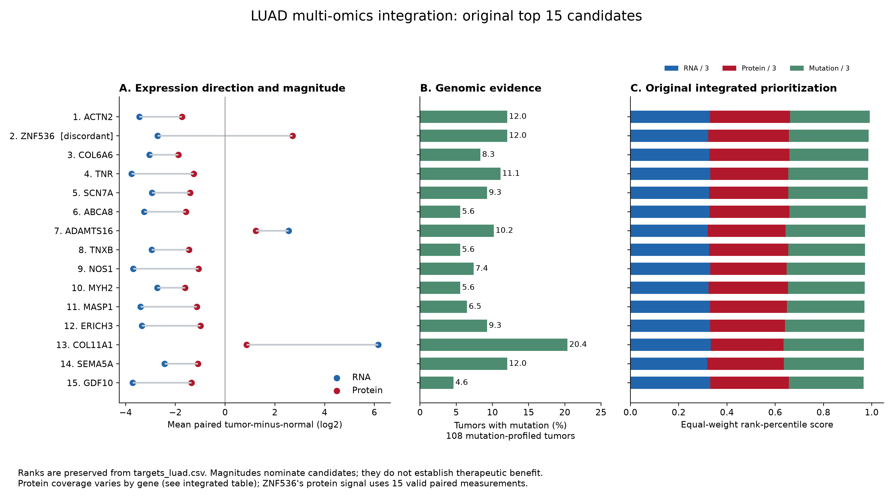
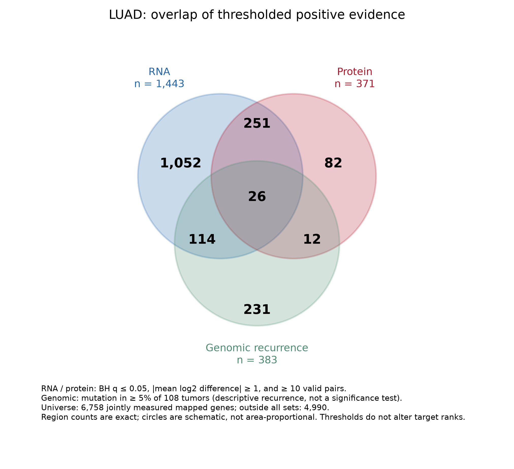

# Module 2 — LUAD Multi-Omics Target Prioritization

**Ajay Kanaparthy · BIOT 6900 · Portfolio Deliverable 1**

This module integrates existing CPTAC lung adenocarcinoma (LUAD) RNA, protein, and somatic mutation measurements at the gene level. It preserves the completed assignment's original scoring method and 15-target hand-off. The results nominate hypotheses; they do not establish therapeutic targets or patient-level causal effects.

## Original work and reproduced results

The completed assignment is [BIOT6900_Module2_Assignment2_LUAD.ipynb](BIOT6900_Module2_Assignment2_LUAD.ipynb). Its executed LUAD analysis and [targets_luad.csv](targets_luad.csv) agree:

- **6,758** genes survive the mapped three-way join.
- **4,918** are RNA–protein sign-concordant; **1,840** are discordant.
- **15** candidates are exported in the original order: ACTN2, ZNF536, COL6A6, TNR, SCN7A, ABCA8, ADAMTS16, TNXB, NOS1, MYH2, MASP1, ERICH3, COL11A1, SEMA5A, and GDF10.
- COL6A6 is rank **3**, SCN7A rank **5**, and MASP1 rank **11**.

Each layer contributes one-third of its rank percentile: absolute RNA effect, absolute protein effect, and mutation frequency. The portfolio evidence thresholds below do **not** change these ranks. The original target CSV remains byte-for-byte unchanged.

`LUAD_Prepare_Data.ipynb` is a retained exploratory preparation notebook. Its optional protein-coverage filter of at least 50 pairs produces a different, sensitivity-analysis ranking; that output does not replace the assignment's hand-off.

## Real data and identifiers

Source: [LinkedOmics CPTAC pan-cancer LUAD download portal](https://www.linkedomics.org/data_download/CPTAC-pancan-LUAD/), using the five existing files in `data/luad_raw/`: tumor/normal RNA, tumor/normal protein, and binary gene-level somatic mutation. The cohort supplies 110 tumor and 101 normal RNA/protein profiles and 108 mutation profiles. The raw sources are retained and their actual SHA-256 hashes are recorded in the verification JSON.

The effect for each gene is the mean **paired tumor-minus-normal log2 difference** over shared sample IDs, with a paired t-test and missing pairs omitted. There are up to 101 pairs, not an unpaired comparison using all 110 tumors. Duplicate version-stripped Ensembl IDs are averaged as in the completed analysis. Mutation frequency is the fraction of the 108 profiled tumors carrying a mutation.

The retained [Ensembl-to-symbol mapping](data/luad_ensembl_symbol_mapping.tsv) makes execution independent of changing annotation services. A live MyGene response no longer maps ENSG00000215695, although the saved analysis previously included it. Both the existing course proteome annotation and a genuine [Ensembl REST lookup](https://rest.ensembl.org/lookup/id/ENSG00000215695?content-type=application/json) identify it as **RSC1A1**. Retained MyGene and Ensembl response JSONs document this repair. ENSG00000130723 remains unavailable, and ENSG00000230626 has no usable gene symbol. No gene symbols or measurements were invented.

## Portfolio figures and captions

### Multi-omics integration



**Figure 1.** Original top-15 LUAD candidates. Panel A shows the actual mean paired RNA and protein effects, retaining direction. Panel B shows observed mutation frequencies. Panel C decomposes the original equal-weight rank-percentile score into RNA, protein, and genomic contributions. The ranking favors large expression changes and recurrent mutation, not demonstrated cancer dependence or druggability. ZNF536 is discordant and has protein measurements in only 15 valid pairs. [PDF version](Figures/luad_multiomics_integration.pdf).

### Positive-evidence overlap

Thresholds are fixed in [luad_evidence_thresholds.json](data/luad_evidence_thresholds.json) before membership and overlap are calculated:

- **RNA:** Benjamini–Hochberg q ≤ 0.05, absolute mean paired log2 difference ≥ 1, and at least 10 valid pairs.
- **Protein:** the same q, effect, and pair-count thresholds.
- **Genomic:** mutation frequency ≥ 5% of the 108 tumors. This is descriptive recurrence, not a mutation-significance test or proof of a driver gene.

BH correction uses all finite tests in each omics layer before restricting to the shared mapped universe. Thresholds are transparent portfolio display choices, not tuned to maximize overlap. Availability in all three matrices is distinct from positive evidence.



**Figure 2.** Three-set Venn of positive evidence within the 6,758 jointly measured and mapped genes. RNA has 1,443 positive genes, protein 371, and genomic recurrence 383. The seven exclusive regions are RNA only **1,052**, protein only **82**, genomic only **231**, RNA+protein only **251**, RNA+genomic only **114**, protein+genomic only **12**, and all three **26**. Another **4,990** genes meet none of the display thresholds. Region counts are exact; circles are schematic and not area-proportional. Direction agreement is not required for set membership, so overlap alone does not imply RNA–protein concordance. [PDF version](Figures/luad_evidence_venn.pdf).

## Known LUAD genes and the discordant hit

| Gene | Original rank | Mutation frequency | Interpretation in this analysis |
|---|---:|---:|---|
| TP53 | 572 | 59.26% | High mutation recurrence; moderate RNA/protein effects reduce the equal-weight rank. |
| KRAS | 1,624 | 32.41% | Recurrent mutation; RNA and protein mean effects have opposite signs. |
| EGFR | 1,807 | 36.11% | Recurrent mutation; modest RNA/protein effects under this scoring rule. |
| ZNF536 | 2 | 12.04% | RNA −2.716 and protein +2.712 log2 units; discordant and based on only 15 valid protein pairs. |

These observed ranks do not measure each gene's overall importance in LUAD. Known LUAD driver biology is discussed in the retained [Module 2 report](LUAD_Multi_Omics_Report.md), with its original literature references. ZNF536 discordance could reflect biological regulation, tissue composition, or technical effects; this analysis does not determine the mechanism.

## Outputs and reproducibility

- [Integrated gene-level table](data/luad_integrated_gene_level.csv): all 6,758 genes, original ranks/scores, signed effects, p-values, layer-wide BH q-values, valid-pair counts, and positive-evidence flags.
- [Evidence-set membership](data/luad_evidence_set_membership.csv): every gene's exact Venn region.
- [Known and discordant genes](data/luad_known_and_discordant_genes.csv).
- [Verification and provenance](data/luad_portfolio_verification.json).
- [Recovery and plotting code](recover_luad_portfolio.py).
- Original notebook, report, and target CSV are preserved in `archive/portfolio_deliverable_1_originals/`; historical `archive/root_copies/` files are also retained.

Activate the `biot6900` environment, set the working directory to `module_2`, and use **Kernel → Restart & Run All** on the original assignment notebook. It uses the retained source matrices and identifier cache without a live annotation request and verifies an existing `targets_luad.csv` instead of overwriting it. To regenerate just the integrated table and figures:

```powershell
conda activate biot6900
cd C:\Users\kanap\OneDrive\Desktop\biot6900\module_2
python recover_luad_portfolio.py
```

Required packages are NumPy, pandas, SciPy, Matplotlib, requests, mygene, and Jupyter; the Venn uses Matplotlib directly. Exact NumPy/pandas versions and source hashes are recorded in the verification JSON. The original BRCA worked example remains in the notebook as course scaffolding, clearly separate from the graded LUAD results.

## Limitations

The original ranking uses magnitude and recurrence, not differential-expression significance, mutation-driver significance, or druggability. Some protein estimates have sparse coverage: ZNF536 15 pairs, MYH2 12, and ADAMTS16 46, compared with 101 for SCN7A and MASP1. Coverage and the separate ≥50-pair sensitivity analysis must accompany interpretation; changing the ranking silently would break the existing cross-module hand-off. Downregulated extracellular-matrix or differentiation markers can rank highly without being useful inhibition targets. Matched source profiles are summarized at gene level, so these ranks cannot establish that a patient's mutation caused that patient's expression change. Independent replication, perturbation studies, and target-specific safety and druggability evidence are required.
